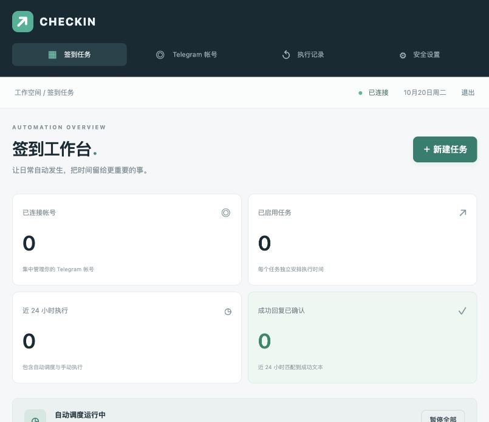

# Telegram 签到工作台

在自己的 Linux 服务器上集中管理多个 Telegram 帐号的定时签到。提供中文 Web 界面、用户名密码登录，以及命令行管理菜单。

**支持：**发送自定义消息、点击回复中的指定文本或回调按钮、校验成功回复、独立 Cron 与时区、手动执行、帐号/任务/全局开关、90 天执行记录、加密会话、备份与更新。

**使用个人 Telegram 帐号登录，需要你自己的 API ID / API Hash；不是 Bot Token。** 每个帐号只需完成一次验证码登录；启用 Telegram 两步验证的帐号还需要输入密码。

<details>
<summary>界面预览（初始空工作台，窄屏布局）</summary>



</details>

## 一键部署

推荐 **Debian 12/13、Ubuntu 24.04+**。需要 systemd、Python 3.11+，服务器必须能连接 GitHub、PyPI 和 Telegram。安装器会用 apt/dnf 安装依赖；旧系统若默认 Python 低于 3.11 会明确停止。

```bash
curl -fsSL https://raw.githubusercontent.com/Jk-z-Box/telegram-checkin-manager/main/install.sh | sudo bash
```

如果已经是 root，且未安装 sudo：

```bash
curl -fsSL https://raw.githubusercontent.com/Jk-z-Box/telegram-checkin-manager/main/install.sh | bash
```

安装时在终端设置管理员用户名与密码（至少 12 字符，不回显）。没有预置密码。安装器需要交互式终端完成这一步，不能在无终端的 CI 管道中首次初始化。

安装完成后：

```bash
sudo tgcheckin
```

打开中文管理菜单。默认 Web 监听 `127.0.0.1:8080`，避免将 Telegram 登录入口直接暴露在公网 HTTP 上。

在你自己的电脑建立 SSH 隧道：

```bash
ssh -N -L 8080:127.0.0.1:8080 用户名@服务器IP
```

然后打开 **http://127.0.0.1:8080**。如果电脑的 8080 被占用，把上面第一个 `8080` 改为 `18080`，访问 `http://127.0.0.1:18080`。

### 用 HTTPS 域名访问

1. 配置域名 DNS，安装 Caddy，并将 [deploy/Caddyfile.example](deploy/Caddyfile.example) 中的域名替换成自己的域名。
2. Caddy 将 HTTPS 转发到 `127.0.0.1:8080`；保持应用监听本机即可。
3. 运行 `sudo tgcheckin config`，把「仅 HTTPS Cookie」设为 `y`，然后 `sudo tgcheckin restart`。
4. 打开自己的 HTTPS 域名登录。

启用 Secure Cookie 后不能再通过普通 HTTP 登录。反向代理必须保留原始 Host，并传递正确的 `X-Forwarded-Proto`；只信任来自本机的代理头。默认 Caddy 反向代理满足这一配置。

## 设置签到

1. 在 [my.telegram.org/apps](https://my.telegram.org/apps) 申请自己的 **API ID / API Hash**。
2. 打开「Telegram 帐号 → 连接帐号」，填写备注、API ID、API Hash 和带国家代码的手机号。
3. 输入 Telegram 官方服务对话或短信发来的验证码。如提示两步验证，再输入 Telegram 两步验证密码。登录流程 5 分钟过期。
4. 在「签到任务 → 新建任务」中选择帐号和目标对话。支持 `@机器人用户名`、公开用户名、对话 ID。也可以点击「选择对话」加载最近 150 个已加入的对话。
5. 填写消息，例如 `/checkin`、`/sign` 或 `签到`。默认每天北京时间 09:00 执行。
6. 按需填写按钮文字与成功回复文本。先手动执行一次，并在 Telegram 和「执行记录」核实。

可以连接多个帐号，并为每个帐号添加多个任务。重新登录同一个 Telegram 帐号会更新现有会话，保留它的任务。

### 计划格式

采用 APScheduler 的五段 Cron：**分 时 日 月 星期**。

| Cron | 计划 |
|---|---|
| `0 9 * * *` | 每天 09:00 |
| `30 8,20 * * *` | 每天 08:30 和 20:30 |
| `0 9 * * mon-fri` | 工作日 09:00 |
| `0 */6 * * *` | 每 6 小时的整点 |

**星期数字是 0=周一、6=周日，与传统 Unix Cron 的星期数字不同。建议使用 `mon`–`sun`。** 每个任务单独设置 IANA 时区，例如 `Asia/Shanghai`、`UTC`。夏令时地区可能有不存在或重复的墙上时间，建议将重要任务安排在非切换时段或使用 UTC。

### 按钮与成功校验

- 按钮文字采用完全匹配。只点击普通文本按钮和回调按钮；不打开链接、不提交联系方式/位置、不执行支付或授权按钮。
- 成功回复采用文本包含匹配，区分大小写。例如填写 `签到成功`。
- 同时配置按钮与成功文本时，点击按钮后收到的消息/编辑事件才能确认成功。
- 群组中只处理**回复本次命令或相关按钮消息**的结果，忽略其他人的消息。只在群里广播消息、却不引用本次命令的机器人可能显示「未确认」。
- 回调弹窗提示本身不计入回复校验；如果机器人只在弹窗中报告结果，可以不填成功文本，并人工核实。
- 不支持验证码识别、自动加入群组、多步交互脚本、WebApp 签到或复杂人机验证。程序不会绕过 Telegram 或机器人限制。

### 结果与调度行为

| 状态 | 含义 |
|---|---|
| 已发送 | 消息已提交，或按钮已点击；未配置成功文本校验 |
| 已确认 | 收到包含配置成功文本的回复 |
| 未确认 | 已发消息，但等待按钮/成功回复超时 |
| 失败 | 例如 Telegram 明确返回 FloodWait |
| 结果未知 | 网络错误、中断或服务停止，可能已经发出消息，需要核实 |
| 已跳过 | 排队时任务/帐号/全局被暂停，或帐号在冷却中 |

不同帐号可并行执行；同一帐号串行处理，发送任务之间保留 2 秒间隔。同一任务手动执行至少间隔 30 秒，且不能重入。

遇到 Telegram `FloodWait` 会保存帐号冷却截止时间，不占着任务一直等待，也不会立即重试。服务重启后仍保留冷却状态。

调度提前保存下一次时间，运行中断记为「结果未知」，**不自动重发**。停机后最多执行 60 秒以内的迟到计划，超过此窗口直接推进到下一次；暂停期间也不积压补发。已发出的消息不能通过暂停撤回。系统不承诺跨网络故障的“恰好一次”投递。

## 命令行

```bash
sudo tgcheckin                    # 中文交互菜单
sudo tgcheckin start              # 启动服务
sudo tgcheckin stop               # 停止服务
sudo tgcheckin restart            # 重启服务
sudo tgcheckin service-status     # systemd 状态
sudo tgcheckin status             # 应用配置摘要
sudo tgcheckin pause              # 暂停全部后续任务
sudo tgcheckin resume             # 恢复调度
sudo tgcheckin config             # 修改监听 IP、端口、Secure Cookie
sudo tgcheckin reset-password     # 修改 Web 密码并退出所有会话
sudo tgcheckin list-jobs          # 查看任务与帐号 ID
sudo tgcheckin toggle-job 1 off   # 关闭任务 1；on 为开启
sudo tgcheckin logs               # 查看服务日志
sudo tgcheckin backup             # 一致性数据库备份
sudo tgcheckin update             # 备份后更新，启动失败自动回滚代码
```

任务详细配置通过 Web 编辑，也可参照 [example.jobs.json](example.jobs.json) 批量新增：

```bash
sudo tgcheckin import-jobs /tmp/my-jobs.json
```

文件须能被 `tgcheckin` 系统用户读取。导入是新增操作，不覆盖原任务。示例默认关闭，避免误发送。目标帐号必须已在 Web 登录。

## 数据、备份与恢复

| 位置 | 用途 |
|---|---|
| `/opt/tgcheckin/releases/` | 独立版本及 Python 虚拟环境 |
| `/opt/tgcheckin/current` | 当前版本符号链接 |
| `/var/lib/tgcheckin/` | 配置、数据库、加密主密钥 |
| `/var/backups/tgcheckin/` | 手动及更新前备份 |
| `/etc/systemd/system/tgcheckin.service` | systemd 服务 |

密码用 Argon2 哈希；手机号、API 凭据、Telegram StringSession 用 Fernet 加密；两步验证密码只用于当前请求，不写入数据库。Web 使用 HttpOnly / SameSite Cookie、CSRF 校验、来源校验和登录限速，登录会话 12 小时到期。API 不返回完整手机号、API Hash 或 Telegram 会话。

**`master.key` 和数据库必须一起备份。** 密钥存放在同一服务器，因此这主要防止单独泄露数据库时暴露会话，无法抵御已取得服务器权限的攻击者。备份包含密钥和登录数据，应视为敏感文件保存，不可提交到 Git。

恢复已知可信的备份：

```bash
sudo tgcheckin stop
sudo tgcheckin backup
sudo install -d -m 700 /var/lib/tgcheckin-restore
sudo tar -xzf /var/backups/tgcheckin/你的备份.tar.gz -C /var/lib/tgcheckin-restore
# 移走旧数据库及其 WAL/SHM，避免与恢复库混用；保留为本地回滚副本
sudo mv /var/lib/tgcheckin /var/lib/tgcheckin-before-restore
sudo mv /var/lib/tgcheckin-restore /var/lib/tgcheckin
sudo chown -R tgcheckin:tgcheckin /var/lib/tgcheckin
sudo chmod 700 /var/lib/tgcheckin
sudo find /var/lib/tgcheckin -type f -exec chmod 600 {} \;
sudo tgcheckin reset-password
sudo tgcheckin start
```

若之前已存在 `tgcheckin-before-restore` 目录，先为旧副本改一个不同名字。重置密码会清除备份中的旧 Web 登录会话。

删除帐号会移除其本地会话和任务，但不会注销 Telegram 设备。如需撤销服务器登录，前往 Telegram「设置 → 设备」结束对应会话。

## 本地运行与开发

```bash
git clone https://github.com/Jk-z-Box/telegram-checkin-manager.git
cd telegram-checkin-manager
python3 -m venv .venv
. .venv/bin/activate
pip install -r requirements.txt
python -m app.cli init
python -m app.cli serve
```

默认数据目录为当前目录的 `data/`。可通过 `TGCHECKIN_DATA=/绝对路径` 改写。只运行一个应用进程；不要使用多个 Uvicorn workers，目录锁会拒绝第二个服务进程。

测试：

```bash
pip install -r requirements-dev.txt
bash scripts/check.sh
```

测试使用模拟 Telegram 客户端，覆盖认证、CSRF、加密、任务管理、调度、限流、备份与按钮处理。它们不向 Telegram 发送真实消息。Linux 安装脚本需要在实际 systemd 主机做安装验证；本地 macOS 开发测试不等于已通过 Linux 部署验收。

[deploy/github-actions-ci.example.yml](deploy/github-actions-ci.example.yml) 提供可选 CI 示例。拥有工作流写入权限后，将它放到 `.github/workflows/ci.yml` 即可启用；仓库默认不包含已启用的 Actions 工作流。

## 技术与参考

Python / FastAPI / Telethon / APScheduler / SQLite。界面无需 Node 构建、外部字体或 CDN，固定依赖版本见 `requirements.txt`。

- [Telegram API 申请](https://core.telegram.org/api/obtaining_api_id)
- [Telethon Session 文档](https://docs.telethon.dev/en/stable/concepts/sessions.html)
- [Telethon 客户端接口](https://docs.telethon.dev/en/stable/modules/client.html)
- [APScheduler Cron 与时区](https://apscheduler.readthedocs.io/en/stable/modules/triggers/cron.html)
- [FastAPI 反向代理](https://fastapi.tiangolo.com/advanced/behind-a-proxy/)

请只操作自己的帐号和允许自动签到的对话，遵守对应机器人及 Telegram 的使用规则。MIT License。
